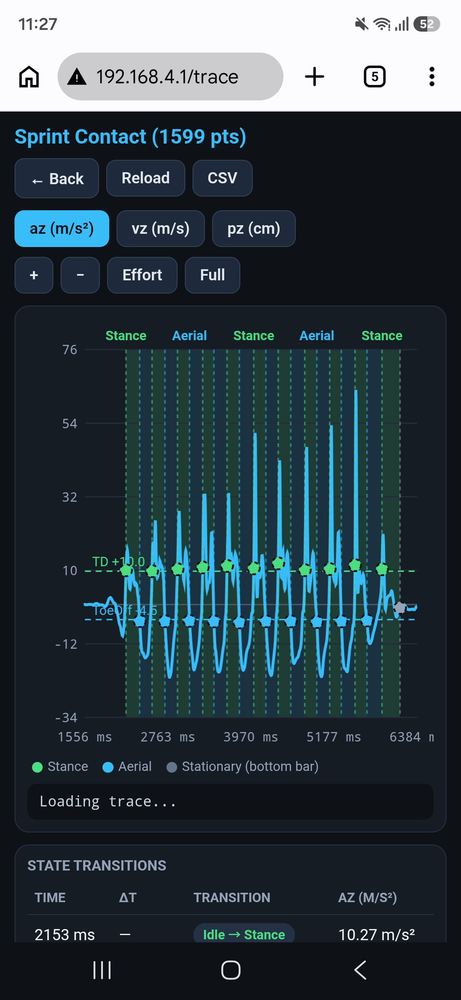

# Barbell & Sprint Performance Tracker

Embedded C++17 / PlatformIO firmware for an ESP32-S3 athletic performance tracker built around a **500 Hz 6-axis IMU**, standalone **1.47" touch display**, and an optional **toggleable Wi-Fi Phone Web UI** with live waveform tracing.



---

## Training Modes

| Mode | Mount | Key Metrics | Status |
| :--- | :--- | :--- | :--- |
| **Barbell VBT** | Barbell / Smith Machine | Best & Set Mean Velocity (`m/s`), Peak Velocity, Velocity Loss (`%`), Peak Reversal Accel (`m/s²`), ROM (`cm`), Conc/Ecc Time, up to 10 reps/set | Ready |
| **Standing Jump (CMJ)** | Lower Back / Waist | Jump Height (`cm`) via flight time, Best & Mean Height, Flight Time (`ms`), Takeoff & Peak Velocity, up to 6 jumps/set | Ready |
| **Sprint Contact** | Lower Back (Sacrum) | Mean & Min Ground Contact Time (`ms`), Mean Flight Time (`ms`), Step Frequency (`Hz`), Odd/Even Asymmetry (`%`), Contact Drift (`ms`), Step Count | Ready |
| **Hurdle Hops** | Lower Back / Waist | Ground Contact Time (`ms`), Rebound Jump Height (`cm`), Reactive Strength Index (RSI) | Skeleton |
| **Block Start** | Lower Back / Waist | First 4 Steps GCT (`ms`), Torso Drive Angle (`deg`), Peak Drive Acceleration | Skeleton |

---

## Hardware

- **Board:** Seeed Studio XIAO 1.47" IPS Touch Display (**XIAO ESP32-S3 Plus**, 240 MHz dual-core, 16 MB Flash, PSRAM)
- **IMU:** LSM6DS3 6-axis IMU over 400 kHz I2C (`±8 g`, `±2000 °/s`, 833 Hz ODR polled at 500 Hz)
- **Display & Touch:** JD9853A 172×320 SPI IPS LCD + AXS5106L I2C capacitive touch
- **Physical Buttons:** `USR1` (`D19` / GPIO 11 — Start / Stop / Next Set) & `USR2` (`D15` / GPIO 42 — Cycle Mode / Back)
- **Power:** 3.7 V LiPo (JST-PH 2.0 mm, battery voltage divider on `D16` / GPIO 10)

---

## Dual UI & Workflow

1. **On-Device 1.47" Touchscreen:**
   - Swipe (or press `USR2`) through the 5 training modes + **Settings** card.
   - Tap **START** (or press `USR1`) → 1-second stationary calibration (`HOLD STILL`) → backlight automatically turns **OFF** during recording to save ~40 mA and eliminate SPI/I2C traffic.
   - Press **`USR1`** when the set/run is finished → backlight turns back on with the full set summary.
   - Tap **NEXT SET** to run Set 2+ immediately without recalibrating.

2. **Toggleable Phone Web UI (`http://vbt.local`):**
   - Wi-Fi is **OFF by default** at boot for maximum battery life.
   - Swipe to **Settings** → tap **WIFI ON** to start the hotspot (`VBT-Tracker`, pass `12345678`).
   - Open **`http://vbt.local`** (or `http://192.168.4.1`) on your phone to control sets remotely and view full rep tables.
   - Open **`http://vbt.local/trace`** after any set to inspect the **250 Hz `az` / `vz` / `pz` waveform**, exact state-machine transition markers, and download `/trace.csv`.

---

## Real-Time Architecture

```text
Core 1 (Priority 5)                      Core 0 (Priority 4 & 2)
───────────────────                      ───────────────────────
500 Hz esp_timer                         processingTask (Prio 4)
  └─► acquisitionTask ──[SPSC Queue]──►    1. ImuCalibrator (1s gyro bias & gravity)
      (LSM6DS3 @ 400 kHz I2C)              2. ImuFilter (20 Hz VBT/Jump, 50 Hz Sprint)
                                           3. OrientationEstimator (6-axis AHRS quaternion)
                                           4. KinematicsEstimator (World Z + ZUPT)
                                           5. Active ActivityAnalyzer + TraceLogger (30 KB RAM)
                                                       │
                                                       ▼
                                         uiTask (Prio 2) — JD9853A Display + Optional WebServer
```

- **Shared I2C Bus Arbitration:** Core 0 Touch owns `Wire` during `IdleModeSelect` / `ResultsReady`; Core 1 IMU owns `Wire` exclusively during `Calibrating` / `Recording`.

---

## Build & Flash

Requires [PlatformIO](https://platformio.org/):

```powershell
# Build firmware
pio run

# Upload to XIAO ESP32-S3 Plus
pio run -t upload

# Optional: enable USB Serial logs & 1 Hz telemetry by setting -DVBT_DEBUG_SERIAL=1 in platformio.ini
pio device monitor
```

---

## Project Structure

```text
├── include/
│   ├── common/       # Vector3, Status bitflags, DebugLog macros
│   ├── config/       # FreeRTOS core affinity, stack sizes, 500 Hz schedule
│   ├── contracts/    # Data types (ImuTypes, KinematicTypes, RepTypes, ModeTypes)
│   ├── imu/          # LSM6DS3 I2C driver
│   ├── processing/   # Calibration, Filter, Orientation, Kinematics, 5 Mode Analyzers, ImuPipeline
│   ├── runtime/      # FreeRTOS tasks, lock-free SPSC queue, TraceLogger
│   └── ui/           # UiManager (1.47" display) & HeadlessWebUi (Wi-Fi AP + mDNS)
├── src/              # Implementation files mirroring include/
├── web/              # Embedded HTML/CSS/JS (index.html & trace.html)
└── platformio.ini    # Board config, C++17 flags, embedded web assets
```
